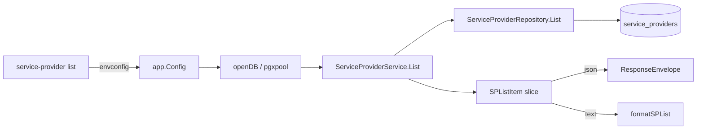

# Design

## Context

The bridge persists service providers in the `service_providers`
Postgres table (`entity_id`, `acs_url`, `acs_binding`,
`attribute_mapping` JSONB). The CLI already has
`service-provider create`, which loads `app.Config` through
`envconfig` from `SAML_PROVIDER_DB_*` variables, opens the pool with
`openDB`, and wraps its handler in `RunHandler` for the standard JSON
envelope. The repository reads one SP with `GetByEntityID`; the
service layer passes it through under a tracer span. See proposal.md
for motivation. See `specs/service-provider-listing/spec.md` for the
behavior contract.

## Goals / Non-Goals

**Goals:**

- Mirror the existing `create` command and `GetByEntityID` patterns
  exactly, so reviewers learn nothing new.
- Return every SP in one deterministic, JSON-safe payload the Juju
  charm can parse after a pebble exec.
- Keep the change read-only and free of schema or HTTP surface
  changes.

**Non-Goals:**

- Admin HTTP list endpoint (see proposal Non-goals and D1).
- Pagination, filtering, or projection flags.
- Changes to `domain.ServiceProvider` or its JSON tags.

## Decisions

### D1. CLI subcommand, not an admin HTTP endpoint

**Choice:** implement the list as
`identity-saml-provider service-provider list`.

**Alternatives considered:**

- `A` `GET /admin/service-providers` without `entity_id`.
- `B` CLI subcommand (chosen).

**Rationale:** the admin API has no authentication today. Option `A`
would expose the full SP inventory on an unauthenticated network
surface. The charm already execs the binary via pebble for `version`
and `migrations apply`, so option `B` fits the existing integration
with no new route. A CLI command also serves operators who hold
database credentials but no HTTP access.

**Trade-off:** callers without exec access to the workload container
cannot list SPs. A future authenticated admin API can revisit `A`.

### D2. Passthrough `List` across repository and service layers

**Choice:** add `List(ctx)` to `ServiceProviderRepository` and
`ServiceProviderService`, mirroring `GetByEntityID`. The service adds
no validation; it starts span `service.sp.list`, calls the repo, and
records span errors.

**Alternatives considered:**

- `A` Query Postgres directly from the cobra command.
- `B` Layered passthrough (chosen).

**Rationale:** option `A` breaks the layering every other command
uses and bypasses tracing. Option `B` keeps mocks and tests uniform
and costs two thin functions.

### D3. Database-level `ORDER BY entity_id`

**Choice:** the Postgres query sorts with `ORDER BY entity_id`.

**Alternatives considered:**

- `A` Sort in Go after the scan.
- `B` Sort in the query (chosen).

**Rationale:** `entity_id` is the primary key, so the sort is cheap
and the ordering guarantee sits next to the data. Callers never see
an unsorted intermediate result.

### D4. DTO mirrors the admin API response shape

**Choice:** add `SPListItem` with JSON tags `entity_id`, `acs_url`,
`acs_binding`, and `attribute_mapping,omitempty`, matching
`GetServiceProviderResponse` in `internal/handler/admin.go`.

**Alternatives considered:**

- `A` Marshal `domain.ServiceProvider` directly.
- `B` A dedicated DTO (chosen).

**Rationale:** `domain.ServiceProvider` has no JSON tags, so option
`A` would leak Go field names. Option `B` reuses the shape operators
already know from the admin GET endpoint and keeps the domain free of
wire concerns.

### D5. Empty inventory serializes as `[]`, never `null`

**Choice:** the command builds a non-nil slice before encoding, so
JSON mode emits `"data":[]` for an empty inventory.

**Rationale:** `json.Unmarshal` of `null` and `[]` differ for the
charm's parser. An empty array keeps the success path uniform. Text
mode prints "no service providers registered" and exits 0; an empty
inventory is not an error.

### D6. Output goes through `RunHandler`

**Choice:** the command's `RunE` calls `RunHandler(cmd, formatSPList, fn)`
with the `SPListItem` slice, exactly as `create` does.

**Rationale:** this inherits the `cli-formatting` envelope, stream
routing, and non-zero exit behavior for free. Errors in JSON mode
return as `HandledError` after the envelope is written.

## Database Schema

No schema changes. The query reads the existing
`service_providers` table and its primary key on `entity_id`.

## Security

The command needs the `SAML_PROVIDER_DB_*` credentials, so its use
stays limited to trusted operators, matching `service-provider
create`. It opens no network listener and adds no admin route. It
never writes to the database.

## Performance

The list reads the full `service_providers` table. SP counts stay in
the tens, so one indexed scan with a sort is sufficient. Pagination
is a deliberate non-goal; revisit it if deployments grow large.

## Observability

The repository starts span `repo.postgres.list_sps` and the service
starts span `service.sp.list`, matching existing span names. Errors
are recorded on the spans. The command uses `logging.NewNopLogger()`
and `tracing.NewNoopTracer()`, as `create` does, because the CLI
process is short-lived.

## Scalability

One query serves each invocation; the CLI holds the pool only for
that query. No shared state or caching is introduced.

## Risks / Trade-offs

- [Full table read grows with SP count] → Accept now; add pagination
  behind a new requirement if deployments exceed a few hundred SPs.
- [Charm depends on the JSON envelope shape] → The shape is pinned by
  formatter tests and by the `cli-formatting` capability, so drift
  fails CI.
- [Empty-slice `null` regression] → The command allocates the slice
  before encoding and a formatter test pins `"data":[]`.

## Migration Plan

Code-only change. Deploy the new image; the charm gains the command
on the next pebble exec. Rollback reverts the image; no persisted
state changes.

## Open Questions

None.
