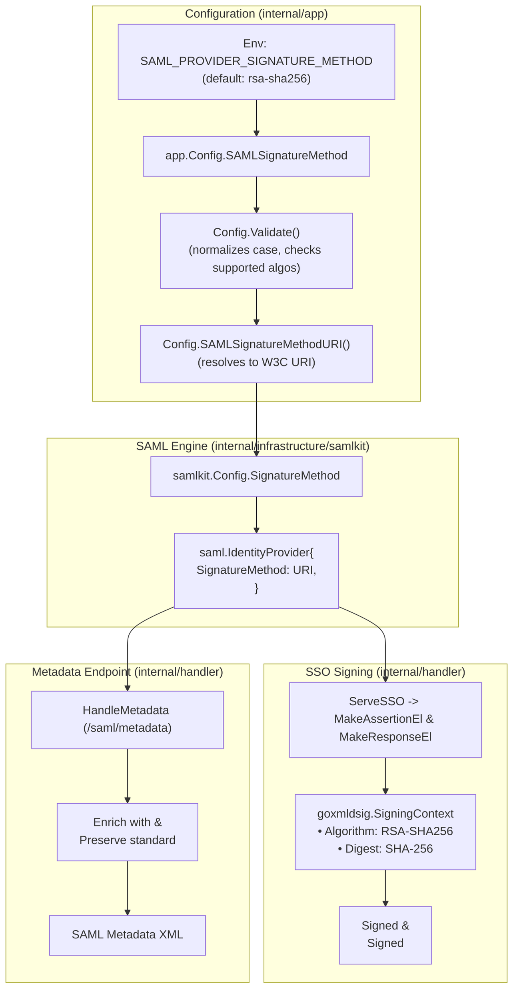

# Design

## Context

See `proposal.md` for motivation.

The application uses `github.com/crewjam/saml` for SAML IdP operations and `github.com/russellhaering/goxmldsig` for XML digital signatures. When `saml.IdentityProvider.SignatureMethod` is unassigned, `crewjam/saml` defaults to `dsig.RSASHA1SignatureMethod` (`http://www.w3.org/2000/09/xmldsig#rsa-sha1`). Modern Service Providers (Stripe, Miro, Microsoft Entra, Google) enforce RSA-SHA256 for both signature and digest verification.

## Goals / Non-Goals

**Goals:**
- Provide `SAML_PROVIDER_SIGNATURE_METHOD` with default `rsa-sha256`, supporting `rsa-sha384`, `rsa-sha512`, and `rsa-sha1`.
- Ensure `saml.IdentityProvider.SignatureMethod` is explicitly populated during IdP initialization.
- Guarantee that both `<saml:Assertion>` and `<saml2p:Response>` are signed with the configured algorithm.
- Publish metadata at `/saml/metadata` containing the standard `<md:KeyDescriptor use="signing">` and OASIS algorithm support extensions (`<alg:SigningMethod>`, `<alg:DigestMethod>`).
- Emit a startup warning if legacy `rsa-sha1` is explicitly chosen.

**Non-Goals:**
- Per-SP database configuration (global configuration meets current architecture requirements).
- Elliptic curve (ECDSA) support with RSA keys.
- Database schema changes or migrations.

## Decisions

### Decision 1: Global IdP Configuration (Option A)

- **Rationale**: In SAML 2.0, an Identity Provider operates a single signing certificate and metadata endpoint for all integrated Service Providers. A global configuration via `SAML_PROVIDER_SIGNATURE_METHOD` provides a clean, operator-friendly interface with zero database migrations.
- **Alternatives Considered**:
  - *Per-SP database column*: Would require a database migration, repository changes, and admin CLI / API updates. Overkill since all modern SPs require SHA-256, and legacy SPs can be supported globally if necessary.

### Decision 2: Dual Metadata Publication (Standard KeyDescriptor + AlgSupport Extension)

- **Rationale**: Strict SPs (like Stripe and Miro) require standard `<md:KeyDescriptor use="signing">` with `<ds:X509Certificate>`. The OASIS SAML 2.0 Metadata Profile for Algorithm Support (`urn:oasis:names:tc:SAML:metadata:algsupport`) specifies `<alg:SigningMethod>` and `<alg:DigestMethod>` within `<md:Extensions>`. Standard XML parsers ignore unknown extension elements, while modern SPs discover algorithm support automatically.
- **Alternatives Considered**:
  - *Only standard KeyDescriptor*: Omits explicit algorithm advertisement in metadata.
  - *Custom non-standard XML tags*: Violates SAML 2.0 metadata schemas.

### Decision 3: Friendly Identifier Normalization and Fail-Fast Validation

- **Rationale**: Operators expect to supply readable identifiers like `rsa-sha256` or `RSA-SHA256` rather than full XMLDSIG URIs (`http://www.w3.org/2001/04/xmldsig-more#rsa-sha256`). Normalizing strings and validating against a known set of constants ensures misconfigurations fail immediately at application startup.
- **Alternatives Considered**:
  - *Accept only full W3C URIs*: Error-prone for human operators.
  - *Ignore invalid algorithms and fallback silently*: Highly dangerous as it could lead to silent degradation to SHA-1.

## Security, Performance, and Observability

- **Security**: Upgrading default to `RSA-SHA256` eliminates the SHA-1 collision vulnerability. Explicit opt-in and warning logs prevent accidental legacy usage.
- **Performance**: RSA-SHA256 signing has negligible CPU difference compared to RSA-SHA1 on modern hardware.
- **Observability**: A warning log is emitted if `rsa-sha1` is configured. Startup logs display the active SAML signature method.
- **Database Schema**: No database schema migrations or tables are altered.

## Risks / Trade-offs

- **[Risk]** A legacy SP strictly requires `RSA-SHA1` and rejects `RSA-SHA256`.
  → **Mitigation**: Operators can set `SAML_PROVIDER_SIGNATURE_METHOD=rsa-sha1` to maintain compatibility with legacy systems.
- **[Risk]** SP metadata parser chokes on `<md:Extensions>`.
  → **Mitigation**: The extension follows the official OASIS SAML 2.0 specification and is placed inside `<md:IDPSSODescriptor>`, preserving the mandatory `<md:KeyDescriptor>` elements intact.
